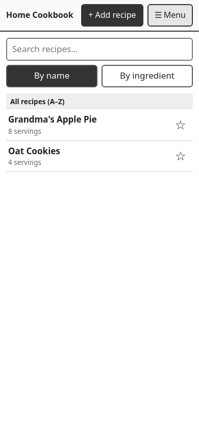
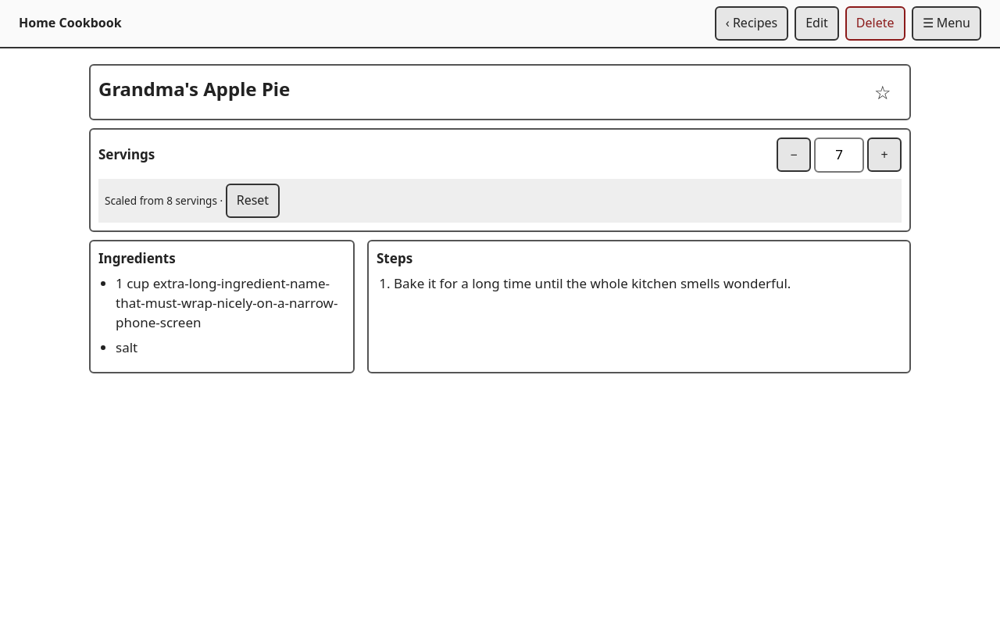
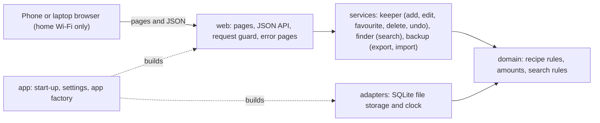

# Home Cookbook

Home Cookbook is a private recipe box for your family's recipes. It runs on your own computer at home, and you open it in a browser on your phone or laptop while you are on the home Wi-Fi. There are no accounts, no cloud and no sharing: the recipes never leave the house.

**Status:** Milestone 3 is built and tested. You can add, read, edit and delete recipes (with Undo), search by name or ingredient, mark favourites, scale servings, and back up and restore with an export file. The last check is yours to do: open the app on your phone on the home Wi-Fi (see "Checks").

## Start it

One time, in the project folder (you need [uv](https://docs.astral.sh/uv/) installed; uv fetches Python 3.12 for you):

```bash
uv sync
```

Every time you want the cookbook running:

```bash
uv run cookbook
```

It prints a line like this (the addresses shown are placeholders; yours are printed by the app):

```
Home Cookbook is running. On your phone or laptop open: http://<lan-ip>:8765 (or http://<computer-name>.local:8765)
```

- **On the computer:** open `http://localhost:8765`.
- **On the phone:** the phone must be on the home Wi-Fi. Open the address from the printed line, `http://<lan-ip>:8765`. The `.local` name also works on networks that support it; if it does not open, use the IP.
- Names your router gives a device (for example `desktop.lan`) are refused on purpose. The app only answers to IP addresses, `localhost` and `.local` names.
- **To stop:** press Ctrl+C in the terminal.
- If it prints `Home Cookbook cannot start: ...` and exits, the reason follows (for example the port is already in use, or a setting is wrong).
- No `.env` file or password is needed. The optional settings are listed under "Settings".

## What works now

- **Add a recipe:** title, servings, ingredients (amount, unit and name; an ingredient can have no amount, like "salt, to taste") and numbered steps. Tap Save and the recipe opens for reading.
- **Read it on the phone:** the recipe page fits a phone screen without sideways scrolling.
- **Edit a recipe:** open a recipe, tap Edit, change anything, tap Save. If the same recipe was saved on another device after you opened the form, Save does not overwrite it. Instead it asks:
  - **"This recipe changed on another device":** *Reload theirs* opens their version and drops what you typed; *Keep mine* saves your version over theirs.
  - **"This recipe was deleted on another device":** *Save as new* saves what you typed as a new recipe; *Discard my changes* goes back to the list and the recipe stays deleted.
  - Nothing is saved until you choose. Leaving the form with unsaved typing (Cancel, or leaving the page) asks "Discard changes?".
- **Delete with Undo:** tap Delete on a recipe. It disappears at once, with no "Are you sure?" question. A bar shows "'Grandma's Apple Pie' deleted · Undo" for 10 seconds. Tap Undo in that time and the recipe comes back exactly as it was, star included. When the bar goes, the delete is final. Deleting a second recipe while the bar is showing makes the first delete final. If you save a new recipe with the same name during the 10 seconds, Undo brings the old one back as "Lemon Cake (2)" and the bar says so.
- **Search by name or ingredient:** the search box is on the list. Choose "name" or "ingredient" and the list narrows while you type, without pressing Enter. "pie" by name finds "Grandma's Apple Pie" and "Shepherd's Pie"; "buttermilk" by ingredient finds the recipes that use buttermilk. Capitals, accents and apostrophes are ignored, and part of a word is enough ("shepherds" finds "Shepherd's Pie"). Results are headed "Matches (A–Z)". If nothing matches, you see "No recipes match 'soup'" with "Clear search", which brings the full list back.
- **Favourites on top:** tap the star on a recipe in the list, or on its page. Favourites are listed first, under "Favourites"; the rest are under "All recipes (A–Z)". Starring does not count as an edit, so it never causes the "changed on another device" question.
- **Scale servings:** on a recipe page, tap − or + or type a number of servings. Every amount updates, with a note "Scaled from 8 servings · Reset". Reset goes back to the saved amounts. Scaling only changes what you see: the saved recipe stays as it was, and a reload shows the saved servings. Small amounts never show 0; they show the smallest sensible measure, such as "1 g", "½" egg or "¼ tsp".
- **Checks when you save:**
  - A title that is already used is refused, with "You already have a recipe called 'Pancakes'. Please choose another name". Nothing is saved until you change it. Titles that differ only in capitals, or in spaces at the start or end, count as the same.
  - Amounts can be whole numbers, decimals, fractions (`1/2`, `1 1/2`) or fraction characters (`½`). They are shown kitchen-style, so `1 1/2` appears as `1½`.
  - A range such as `2-3` is refused: "Enter one amount, e.g. 2 or 2½".
  - A blank title, or servings of 0, keeps the form open with a message by that field.
- **Back up and restore:** download every recipe to one file from the menu, and load that file back in later. See "Back up and restore".

## Screenshots

Recipe list on a phone (390 px wide):



Recipe page on a laptop (1280 px wide):



Edit form on a phone (390 px wide):


## Back up and restore

The export file is the recommended backup. It holds every recipe in one file, and you can load it back in on this computer or on a new one.

### How to export

1. Tap **Menu** in the top bar.
2. Tap **Export all recipes**.
3. The browser downloads one file named `cookbook-<date>.json`, for example `cookbook-2026-11-13.json`. The date is the date on the home computer.

The file lands in the Downloads folder of the phone or laptop you tapped on. Some browsers ask where to save it first; pick a folder you will find again.

Keep the file safe and private:

- Copy it somewhere safe, such as a USB stick or a drive you keep at home.
- It holds every recipe as plain, readable text, so anyone who opens it can read the recipes. Do not share it.
- A backup only holds what was in the app when you exported. Export again after you add recipes.

### How to import

1. Tap **Menu**, then **Import recipes**.
2. Choose the export file from the device.
3. A message appears under the top bar saying what happened. Read the table below.

Import is all or nothing. Either the whole file is loaded, or the file is refused and nothing changes. Recipes already in the app are never changed or removed by an import.

Files made by any earlier version of the app load into the current version.

### What the import message means

| Message | What it means |
|---|---|
| Imported 42 recipes | Every recipe in the file was added. |
| Imported 40 recipes · skipped 2 with the same title: Lemon Cake, Shepherd's Pie. To restore one, delete it first, then import again | 40 were added. The two named recipes already exist in the app with the same title (capitals and spaces at the ends are ignored), so the copies in the file were not added. The recipes in the app were not changed. |
| … · renamed 1 with a repeated title | The file held two recipes with the same title. The second one was added with " (2)" after its title, for example "Pancakes (2)". |
| This file isn't a Home Cookbook export; nothing was changed | The file is not an export from this app (for example a photo), or it is damaged. Nothing was added. |
| This file was made by a newer version of Home Cookbook. Update the app to load it; nothing was changed | The file was made by a newer version of the app than the one running. Nothing was added. Update Home Cookbook, then import again. |

A skipped recipe can only be brought back by deleting the one in the app first (see "Delete with Undo"), waiting for the Undo bar to go so the delete is final, and then importing the file again.

<details>
<summary>Technical detail: the file format</summary>

- UTF-8 JSON with the recipes in a `recipes` list. The top fields are `format` (always `home-cookbook-export`), `format_version` (currently 1), `app_version`, `exported_at` and `recipe_count`.
- Every later version of the app must load every older format version. A file with a `format_version` the running app does not know is refused.
- A file is also refused if its `recipe_count` does not match the number of recipes it holds.

</details>

### Alternative: copy the database file by hand

You can also back up the database file itself, in place of the export file:

1. Stop the app (Ctrl+C in the terminal).
2. Copy `cookbook.db` from the data folder (see "Where the data lives").
3. If `cookbook.db-wal` or `cookbook.db-shm` sits next to it, copy those too.

To restore from such a copy, stop the app and copy the files back into the data folder. The export file is easier to keep and to restore, because the menu does the work.

## Not yet

Everything in the plan is built. Some things are left out on purpose (see `docs/SPEC.md` section 11): no accounts or logins, no cloud or online sync, no sharing, no use away from home, no meal planning or shopping lists, no unit conversion, no photos, and no import from other recipe apps.

## Settings

Settings are environment variables. The app reads them from the shell; it does not read the `.env` file. Put them in front of the command:

```bash
COOKBOOK_PORT=8800 uv run cookbook
```

| Variable | Default | What it does |
|---|---|---|
| `COOKBOOK_HOST` | `0.0.0.0` | The network address the app listens on. The default means every network connection of this computer, so the phone can reach it. |
| `COOKBOOK_PORT` | `8765` | The port the phone and laptop use. A whole number from 1 to 65535. The address the app prints changes with it. |
| `COOKBOOK_DB` | `~/.local/share/home-cookbook/cookbook.db` | Where the recipes are stored. Leave it unset for the default. |
| `COOKBOOK_UNDO_SECONDS` | `10` | How many seconds a deleted recipe can be undone (the length of the Undo bar), from 1 to 3600. |

## Where the data lives

All recipes are in one file, `cookbook.db`, in `~/.local/share/home-cookbook/` (or in `$XDG_DATA_HOME/home-cookbook/` if that variable is set). The app creates the folder and file the first time it starts. The file is kept outside the project folder, so reinstalling or updating the code does not touch your recipes.

The database is the only live copy, so back it up regularly: export all recipes to a file (see "Back up and restore"). Anything added since your last export is lost if the home computer's data is lost.

## Checks

How to test: run `scripts/check.sh`. It ends with `CHECK OK` or `CHECK FAILED`. At Milestone 3 it runs 516 tests, with 93% coverage (the threshold is 80%).

<details>
<summary>How to run the checks (for the owner or a developer)</summary>

- Full check (lint, format, types, complexity, layer rules, tests with 80% coverage, secrets scan): `scripts/check.sh`.
- Without the coverage threshold (quicker while coding): `CHECK_NO_COVERAGE=1 scripts/check.sh`
- Tests only: `uv run pytest`
- Fast tests only (no browser): `uv run pytest -q tests/unit tests/integration`
- Browser tests only: `uv run pytest -q tests/e2e`
- One time, for the browser tests: `uv run playwright install --only-shell chromium`
- One time after cloning: `scripts/install-hooks.sh`
- Quick browser smoke script: `uv run python -I scripts/smoke_playwright.py`
- The end-to-end tests (`tests/e2e/`) include:
  - `test_definition_of_done.py`: the whole journey from the spec's Definition of done, against the real app started with `uv run cookbook`: add on the phone and see it on the laptop, search by name and ingredient, scale 8 to 4 servings (saved recipe unchanged), a favourite on top, delete then Undo, export, then import into a fresh app.
  - `test_layout_at_home.py`: the real app answers at its LAN address (not only 127.0.0.1) from a 390×844 phone and a 1280×800 laptop; no sideways scroll at 390 px; buttons at least 44 px tall. Skipped if the machine has no LAN address.
- Screenshots: set `COOKBOOK_TEST_SHOTS` to a folder and the browser tests save the list, recipe and edit screens there, for example `COOKBOOK_TEST_SHOTS=.results/T-10 uv run pytest -q tests/e2e`.

</details>

## For developers

<details>
<summary>Architecture and project layout</summary>



- **Stack:** Python 3.12, Flask with Jinja pages, the waitress server, SQLite (standard library), plain JavaScript. No build step and no Node.
- **Layers:** `domain` holds the recipe rules (no input or output), amount rules and search rules. `services` holds the keeper (add, read, edit, favourite, delete with undo), finder (search by name or ingredient) and backup (export and import). `adapters` holds the SQLite storage. `web` holds the pages, the JSON endpoints and the request guard, and `app` starts everything. The import-linter check enforces these rules.
- **Start-up order:** settings from the environment, then the stop-signal handler, then the data file (created or migrated), then the port is bound, then the address banner is printed, then the server runs.
- **Request guard:** only private or loopback addresses are served. The Host name must be an IP, `localhost` or a `.local` name. Cross-site writes are refused.
- **Browser code:** `static/js/` has shared modules (`api.js`, `undo.js`, `favourite.js`, `scaler.js`) and one module per page (`list.js`, `view.js`, `edit.js`, `menu.js`). The scaler is pure logic with no page access, and is tested through `window.cookbookScaler`.
- **Layout:**
  - `src/cookbook/app/`: start-up, settings, app factory
  - `src/cookbook/domain/`: recipe rules, amounts, search rules
  - `src/cookbook/adapters/`: SQLite storage
  - `src/cookbook/services/`: keeper, finder, backup (export and import)
  - `src/cookbook/web/`: pages, API, guard, error pages
  - `src/cookbook/templates/` and `src/cookbook/static/`: HTML, CSS and JavaScript
  - `tests/`: unit, integration and end-to-end tests
  - `docs/`: `SPEC.md` (what it does, user stories) and `LLD.md` (how it is built; section 0 covers start-up and settings, and "Changes since last milestone" lists what changed in each milestone)
  - `.env.example`: the settings with their defaults
- **Dependencies:** `uv.lock` pins the exact versions. Install with `uv sync`.

</details>
