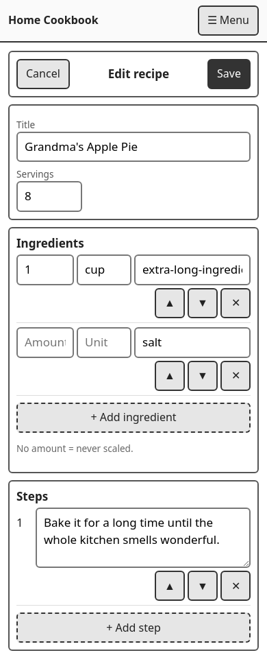
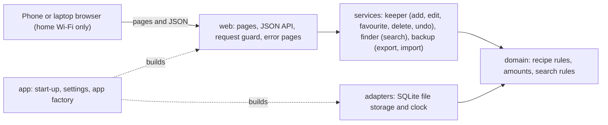

# Home Cookbook

Home Cookbook is a private recipe box for your family's recipes. It runs on your own computer at home, and you open it in a browser on your phone or laptop while you are on the home Wi-Fi. There are no accounts, no cloud and no sharing: the recipes never leave the house.

**Status:** Handed over. Every planned feature is built and tested (516 automatic tests at handover, about 93% of the code covered by them). The owner has opened the app on a phone over the home Wi-Fi and confirmed it works.

## Screenshots

Recipe list on a phone (390 px wide):


Recipe page on a laptop (1280 px wide):


Edit form on a phone (390 px wide):



## What it does

- **Add a recipe:** title, servings, ingredients (amount, unit and name; an ingredient can have no amount, like "salt, to taste") and numbered steps. Tap Save and the recipe opens for reading.
- **Read it on the phone:** the recipe page fits a phone screen without sideways scrolling.
- **Edit a recipe:** open a recipe, tap Edit, change anything, tap Save. If the same recipe was saved on another device after you opened the form, Save does not overwrite it. Instead it asks:
  - **"This recipe changed on another device":** *Reload theirs* opens their version and drops what you typed; *Keep mine* saves your version over theirs.
  - **"This recipe was deleted on another device":** *Save as new* saves what you typed as a new recipe; *Discard my changes* goes back to the list and the recipe stays deleted.
  - Nothing is saved until you choose. Leaving the form with unsaved typing (Cancel, or leaving the page) asks "Discard changes?".
- **Delete with Undo:** tap Delete on a recipe. It disappears at once, with no "Are you sure?" question. A bar shows "'Grandma's Apple Pie' deleted" with an Undo button for 10 seconds. Tap Undo in that time and the recipe comes back exactly as it was, star included. When the bar goes, the delete is final. Deleting a second recipe while the bar is showing makes the first delete final. If you save a new recipe with the same name during the 10 seconds, Undo brings the old one back as "Lemon Cake (2)" and the bar says so.
- **Search by name or ingredient:** the search box is on the list. Choose "by name" or "by ingredient" and the list narrows while you type, without pressing Enter. "pie" by name finds "Grandma's Apple Pie" and "Shepherd's Pie"; "buttermilk" by ingredient finds the recipes that use buttermilk. Capitals, accents and apostrophes are ignored, and part of a word is enough ("shepherds" finds "Shepherd's Pie"). Results are headed "Matches (A–Z)". If nothing matches, you see "No recipes match 'soup'" with "Clear search", which brings the full list back.
- **Favourites on top:** tap the star on a recipe in the list, or on its page. Favourites are listed first, under "★ Favourites"; the rest are under "All recipes (A–Z)". Starring does not count as an edit, so it never causes the "changed on another device" question.
- **Scale servings:** on a recipe page, tap − or + or type a number of servings. Every amount updates, with a note "Scaled from 8 servings · Reset". Reset goes back to the saved amounts. Scaling only changes what you see: the saved recipe stays as it was, and a reload shows the saved servings. Small amounts never show 0; they show the smallest sensible measure, such as "1 g", "½" egg or "¼ tsp".
- **Checks when you save:**
  - A title that is already used is refused, with "You already have a recipe called 'Pancakes'. Please choose another name". Nothing is saved until you change it. Titles that differ only in capitals, or in spaces at the start or end, count as the same.
  - Amounts can be whole numbers, decimals, fractions (`1/2`, `1 1/2`) or fraction characters (`½`). They are shown kitchen-style, so `1 1/2` appears as `1½`.
  - A range such as `2-3` is refused: "Enter one amount, e.g. 2 or 2½".
  - A blank title, or servings of 0, keeps the form open with a message by that field.
- **Back up and restore:** download every recipe to one file from the menu, and load that file back in later. See "Back up and restore".

## How to run

### What you need

- A computer that stays on at home (the app runs on it).
- [uv](https://docs.astral.sh/uv/) installed. uv fetches Python 3.12 for you.
- The project folder (a Git clone of this project). Internet access is needed only for the one-time setup steps below.
- No account, no password and no keys from any website.

### Set up (one time, on the home computer)

Run these in the project folder, in this order:

```bash
uv sync
uv run playwright install --only-shell chromium
scripts/install-hooks.sh
```

- `uv sync` installs Python 3.12 and every library the app needs, at the exact versions in `uv.lock`.
- `uv run playwright install --only-shell chromium` downloads the headless browser that the browser tests use. The app itself does not need it, but the browser tests and `scripts/check.sh` do, so do it once.
- `scripts/install-hooks.sh` turns on a quick check that runs before every Git commit. It must be run inside the Git clone, because it installs the hook into the clone's `.git` folder.

### Start the app

Every time you want the cookbook running:

```bash
uv run cookbook
```

It prints a line like this (the addresses shown are placeholders; yours are printed by the app):

```
Home Cookbook is running. On your phone or laptop open: http://<lan-ip>:8765 (or http://<computer-name>.local:8765)
```

Leave that window open. The app runs only while this command is running; it does not start by itself when the computer turns on.

### Open it

- **On the computer:** open `http://localhost:8765`.
- **On a phone or laptop:** the device must be on the **same home Wi-Fi** as the computer. Open the address from the printed line, `http://<lan-ip>:8765` (the number the app prints, for example `http://192.168.x.x:8765`). The `.local` name also works on networks that support it; if it does not open, use the number.
- Names your router gives a device (for example `desktop.lan`) are refused on purpose. The app only answers to IP addresses, `localhost` and `.local` names.

### Stop the app

Press Ctrl+C in the window where `uv run cookbook` is running.

### If it does not start

If it prints `Home Cookbook cannot start: ...` and exits, the reason follows (for example the port is already in use, or a setting is wrong). Fix that, then start it again. To use another port for one run:

```bash
COOKBOOK_PORT=8800 uv run cookbook
```

### Settings

Settings are optional environment variables. The app reads them from the shell; it does **not** read a `.env` file. The file `.env.example` lists them with their defaults, for reference. You can leave all of them unset.

| Variable | Default | What it does |
|---|---|---|
| `COOKBOOK_HOST` | `0.0.0.0` | The network address the app listens on. The default means every network connection of this computer, so the phone can reach it. |
| `COOKBOOK_PORT` | `8765` | The port the phone and laptop use. A whole number from 1 to 65535. The address the app prints changes with it. |
| `COOKBOOK_DB` | `~/.local/share/home-cookbook/cookbook.db` | Where the recipes are stored. Leave it unset for the default. |
| `COOKBOOK_UNDO_SECONDS` | `10` | How many seconds a deleted recipe can be undone (the length of the Undo bar), from 1 to 3600. |

## How to test

Run these in the project folder.

| Command | What it does |
|---|---|
| `scripts/check.sh` | The full check: lint, format, types, complexity, layer rules, all tests with an 80% coverage minimum, and a secrets scan. It ends with `CHECK OK` or `CHECK FAILED`. |
| `CHECK_NO_COVERAGE=1 scripts/check.sh` | The same check without the coverage minimum. Quicker while you are coding. |
| `uv run pytest` | All the tests (the browser tests need the one-time Chromium step above). |
| `uv run pytest -q tests/unit tests/integration` | The fast tests only (no browser). |
| `uv run pytest -q tests/e2e` | The browser tests only. |
| `uv run python -I scripts/smoke_playwright.py` | A quick browser smoke test. It opens a phone-sized page, closes the browser, and fails if closing takes 5 seconds or more. |

What the browser tests cover:

- `tests/e2e/test_definition_of_done.py` runs the whole journey from the spec's Definition of done against the real app started with `uv run cookbook`: add on the phone and see it on the laptop, search, scale, favourite, delete then Undo, export, and import into a fresh app.
- `tests/e2e/test_layout_at_home.py` checks the real app at its home-network address from a phone-sized and a laptop-sized screen. It is skipped if the computer has no home-network address.

To keep screenshots, set `COOKBOOK_TEST_SHOTS` to a folder. Only the layout test (`tests/e2e/test_layout_at_home.py`) reads it; it saves the list, recipe and edit screens there. For example:

```bash
COOKBOOK_TEST_SHOTS=.results/shots uv run pytest -q tests/e2e
```

### Automatic checks on GitHub

`.github/workflows/ci.yml` runs `scripts/check.sh` on GitHub for every push to `main` and every pull request. It is ready, but it does not run yet: today the project's Git remote is a local repository on the home computer. Once the code is pushed to GitHub, it starts working:

```bash
git remote set-url origin <your-github-address>
git push -u origin --all
```

## How to extend

For the step-by-step tour of the code, read [docs/WALKTHROUGH.md](docs/WALKTHROUGH.md). Its section 4 lists each kind of change (a new endpoint, a new screen, a new text, a new setting, a new export version, a new database column) with the files to touch and an existing example to copy. For how the parts fit together, read [docs/ARCHITECTURE.md](docs/ARCHITECTURE.md).

Three rules keep the code safe to change:

- Run `scripts/check.sh` after every change. It must end with `CHECK OK`.
- The layers are enforced: the web layer may not reach the database directly, and the recipe rules may not import the web framework. `uv run lint-imports` (part of `scripts/check.sh`) fails if a change breaks this.
- Never edit an export format or a database migration that has already shipped. Add a new step instead (see WALKTHROUGH section 4).

## Architecture

Home Cookbook is a Python web app. The browser talks only to the web layer; the web layer asks three services (keeper, finder, backup) to do the work; the services follow the recipe rules and reach the data file only through a storage adapter. One start-up file wires everything together.



- **Tech stack:** Python 3.12 (managed by uv), Flask with Jinja pages, the waitress server, SQLite (from the Python standard library), plain JavaScript. Tests use pytest and Playwright (Chromium). Quality tools: ruff, mypy, import-linter, radon, detect-secrets. No build step and no Node.
- **Layers:** `domain` holds the recipe rules, amount rules and search rules, and knows nothing about the web or the database. `services` holds the keeper, finder and backup use cases. `adapters` holds the SQLite storage and the clock. `web` holds the pages, the JSON endpoints, the request guard and the error mapping. `app` starts everything.
- **Start-up order:** settings from the environment, then the stop-signal handler, then the data file (created or upgraded), then the port is opened, then the address line is printed, then the server runs.
- **Request guard:** only private or home-network addresses are served. The host name must be an IP address, `localhost` or a `.local` name. Requests from other websites that try to change data are refused.
- **Browser code:** `static/js/` has shared modules (`api.js`, `undo.js`, `favourite.js`, `scaler.js`) and one module per page (`list.js`, `view.js`, `edit.js`, `menu.js`).

Full details, with the request flows and design decisions, are in [docs/ARCHITECTURE.md](docs/ARCHITECTURE.md). The detailed design is in [docs/LLD.md](docs/LLD.md), and what the app does (user stories and the Definition of done) is in [docs/SPEC.md](docs/SPEC.md).

## Project structure

```
pyproject.toml, uv.lock, .python-version   Python version, libraries and tool settings
.env.example                               The optional settings, for reference
.github/workflows/ci.yml                   The automatic checks on GitHub (see How to test)
scripts/                                   check.sh, install-hooks.sh, pre-commit-hook.sh, smoke_playwright.py
src/cookbook/
  __main__.py                              Lets "python -m cookbook" start the app
  app/        factory.py, config.py, serve.py     start-up, settings, app factory
  domain/     models.py, rules.py, amounts.py, search.py, errors.py, ports.py
  adapters/   schema.py, sqlite_repo.py, clock.py  SQLite storage and clock
  services/   keeper.py, finder.py, backup/       recipe keeper, search, export and import
  web/        pages.py, api.py, guard.py, errors.py, messages.py   pages, JSON API, guard, texts
  templates/  HTML pages      static/   CSS and browser JavaScript
tests/        unit/, integration/, e2e/ (browser), fixtures/exports/ (a frozen sample export)
docs/         SPEC.md, LLD.md, ARCHITECTURE.md, WALKTHROUGH.md, CONVENTIONS.md, images/
```

## Back up and restore

The export file is the recommended backup. It holds every recipe in one file, and you can load it back in on this computer or on a new one.

### How to export

1. Tap **Menu** in the top bar.
2. Tap **Export all recipes**.
3. The browser downloads one file named `cookbook-<date>.json`, for example `cookbook-2026-11-13.json`. The date is the date on the home computer.

The file lands in the Downloads folder of the phone or laptop you tapped on. Some browsers ask where to save it first; pick a folder you will find again.

Keep the file safe and private:

- Copy it somewhere safe, such as a USB stick or a drive you keep at home.
- It holds every recipe as plain, readable text, so anyone who opens it can read the recipes. Do not share it.
- A backup only holds what was in the app when you exported. Export again after you add recipes.

### How to import

1. Tap **Menu**, then **Import recipes**.
2. Choose the export file from the device.
3. A message appears under the top bar saying what happened. Read the table below.

Import is all or nothing. Either the whole file is loaded, or the file is refused and nothing changes. Recipes already in the app are never changed or removed by an import.

Files made by any earlier version of the app load into the current version.

### What the import message means

| Message | What it means |
|---|---|
| Imported 42 recipes | Every recipe in the file was added. |
| Imported 40 recipes · skipped 2 with the same title: Lemon Cake, Shepherd's Pie. To restore one, delete it first, then import again | 40 were added. The two named recipes already exist in the app with the same title (capitals and spaces at the ends are ignored), so the copies in the file were not added. The recipes in the app were not changed. |
| … · renamed 1 with a repeated title | The file held two recipes with the same title. The second one was added with " (2)" after its title, for example "Pancakes (2)". |
| This file isn't a Home Cookbook export; nothing was changed | The file is not an export from this app (for example a photo), or it is damaged. Nothing was added. |
| This file was made by a newer version of Home Cookbook. Update the app to load it; nothing was changed | The file was made by a newer version of the app than the one running. Nothing was added. Update Home Cookbook, then import again. |

A skipped recipe can only be brought back by deleting the one in the app first (see "Delete with Undo"), waiting for the Undo bar to go so the delete is final, and then importing the file again.

<details>
<summary>Technical detail: the file format</summary>

- UTF-8 JSON with the recipes in a `recipes` list. The top fields are `format` (always `home-cookbook-export`), `format_version` (currently 1), `app_version`, `exported_at` and `recipe_count`.
- Every later version of the app must load every older format version. A file with a `format_version` the running app does not know is refused.
- A file is also refused if its `recipe_count` does not match the number of recipes it holds.
- A frozen sample of this format is in `tests/fixtures/exports/v1-basic.json`.

</details>

### Alternative: copy the database file by hand

You can also back up the database file itself, in place of the export file:

1. Stop the app (Ctrl+C in the terminal).
2. Copy `cookbook.db` from the data folder (see "Where the data lives").
3. If `cookbook.db-wal` or `cookbook.db-shm` sits next to it, copy those too.

To restore from such a copy, stop the app and copy the files back into the data folder. The export file is easier to keep and to restore, because the menu does the work.

## Where the data lives

All recipes are in one file, `cookbook.db`, in `~/.local/share/home-cookbook/` (or in `$XDG_DATA_HOME/home-cookbook/` if that variable is set). The app creates the folder and file the first time it starts. The file is kept outside the project folder, so reinstalling or updating the code does not touch your recipes.

The database is the only live copy, so back it up regularly: export all recipes to a file (see "Back up and restore"). Anything added since your last export is lost if the home computer's data is lost.

## Not yet

Everything in the plan is built. Some things are left out on purpose (see `docs/SPEC.md` section 11): no accounts or logins, no cloud or online sync, no sharing, no use away from home, no meal planning or shopping lists, no unit conversion, no photos, and no import from other recipe apps. The app also does not start by itself when the computer boots (left out on purpose).

Known small issues (wording, tidying and tests, not missing features) are listed in `docs/ARCHITECTURE.md`, section 8 "Quality gates", under "Known limitations and tech debt".
