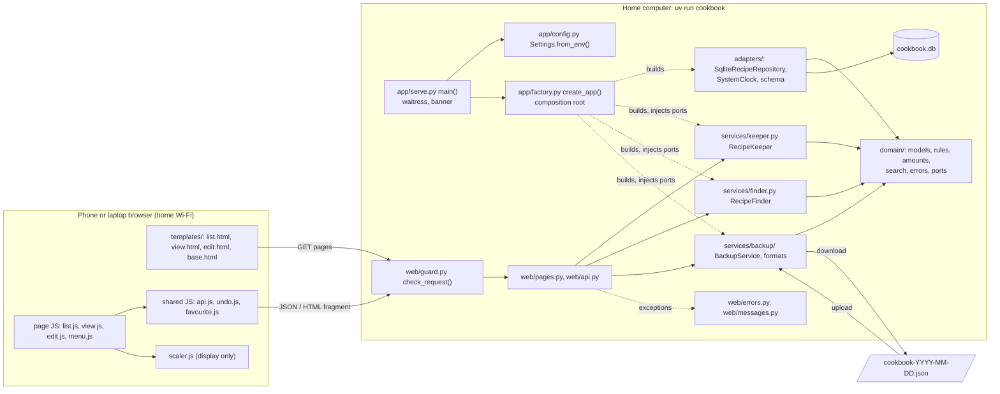
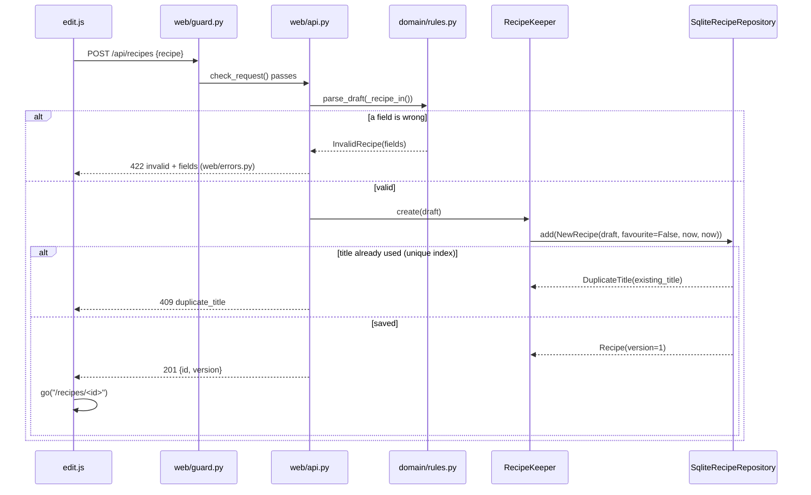
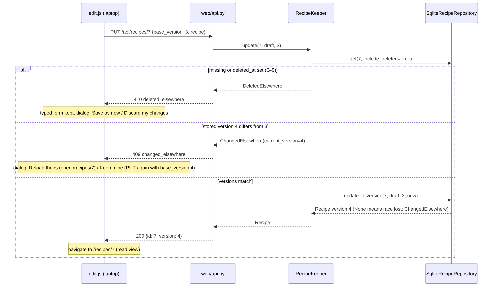
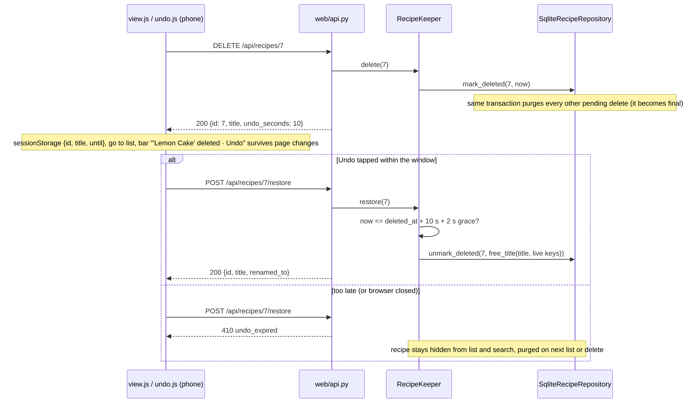
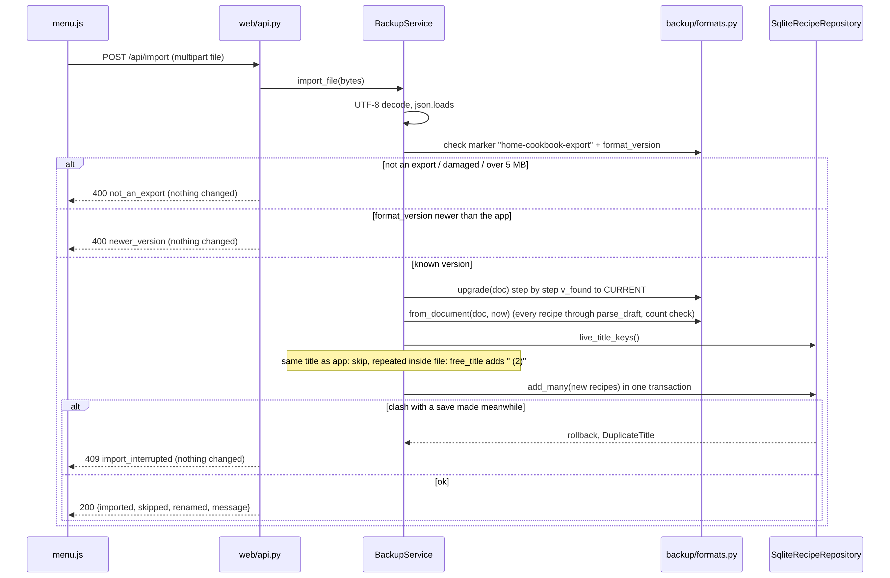
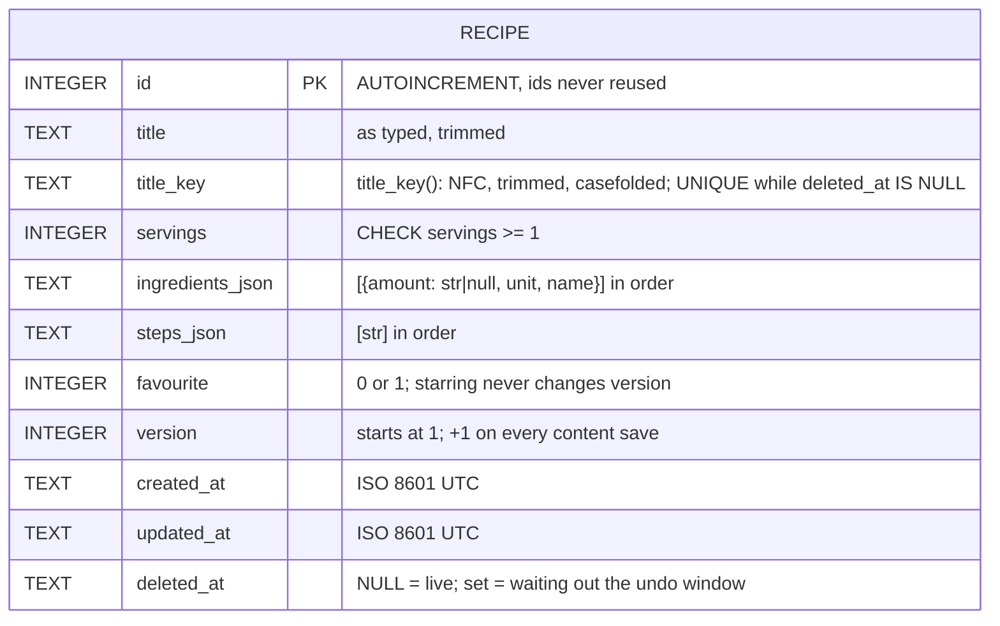

# Architecture (as built) — Home Cookbook

> Final, as-built description written at handover by the architect, from the code, not
> from the original plan. Deviations from the plan are listed in §7.
> Plain-words summary first in each section; the technical detail is folded away under
> "Technical detail" so you can open it when you need it.

## 1. What it is

Home Cookbook is a small website that runs on the home computer and keeps the family's recipes in one file there. You open it in the browser of a phone or laptop on the home Wi-Fi to add, find, scale, star, delete (with Undo), back up and restore recipes. It refuses anyone outside the home network, and there are no accounts, no cloud and no build step.

Technical detail

- Python 3.12 (uv), Flask 3.1.3 with Jinja templates, served by waitress 3.0.2 (4 threads) on `0.0.0.0:8765`.
- Storage: one SQLite file (`~/.local/share/home-cookbook/cookbook.db` by default), WAL mode, `synchronous=FULL`.
- Browser side: plain JavaScript ES modules in `src/cookbook/static/js/`, no Node, no libraries.
- Start command: `uv run cookbook`, which runs `cookbook.app.serve:main` (`pyproject.toml`, `[project.scripts]`).

## 2. System diagram

In plain words: the browser talks only to the web layer; the web layer asks three "services" (keeper, finder, backup) to do the work; the services follow the recipe rules in the domain layer and reach the data file only through a storage adapter. One start-up file wires everything together.

Earlier diagrams that still hold: the plain-words data flow `docs/hld-dataflow.png` (source `docs/hld-dataflow.mmd`) and the planned component diagram `docs/diagrams/lld-components.png` (source `docs/diagrams/lld-components.mmd`; it predates `favourite.js`, otherwise as built).

## 3. Components

| Component | Path | Responsibility | Depends on |
|---|---|---|---|
| Entry point | `src/cookbook/__main__.py`, `src/cookbook/app/serve.py` | `main()`: read settings, install the stop handler, build the app, bind the port, print the address banner, serve; exit code 2 with one line if it cannot start | config, factory, waitress |
| Settings | `src/cookbook/app/config.py` | `Settings` and `Settings.from_env()`: the only place that reads environment variables | stdlib |
| Composition root | `src/cookbook/app/factory.py` | `create_app(settings, clock=None)`: builds the SQLite repository, the three services and the Flask app; registers guard, error handlers, blueprints | everything below |
| Request guard | `src/cookbook/web/guard.py` | `check_request()`: home addresses only, Host must be an IP, `localhost` or `*.local`, same-site writes only | messages |
| Pages | `src/cookbook/web/pages.py` | HTML routes `/`, `/recipes/_list`, `/recipes/new`, `/recipes/<id>`, `/recipes/<id>/edit`; `list_context()`, `ingredient_line()`, `form_data()` | services, domain |
| JSON API | `src/cookbook/web/api.py` | `/api/recipes` (create, update, favourite, delete, restore), `/api/import`, and `/export` (mounted by `_mount_export`) | services, domain rules |
| Error mapping | `src/cookbook/web/errors.py` | `BUILDERS` table: each domain error to a status, code and text; JSON under `/api/`, `error.html` elsewhere | domain errors, messages |
| Texts | `src/cookbook/web/messages.py` | Every user-facing text, including `UI_TEXTS` for the browser | backup `ImportResult` |
| Recipe keeper | `src/cookbook/services/keeper.py` | `RecipeKeeper`: create, get, update with version check, set favourite, delete, restore within the undo window, list | domain ports and rules |
| Recipe finder | `src/cookbook/services/finder.py` | `RecipeFinder.search(query, by)` over live recipes | domain ports, rules, search |
| Backup | `src/cookbook/services/backup/service.py`, `formats.py` | `BackupService.export_all()` / `import_file()`; file format v1, `upgrade()` steps, strict field checks | domain ports and rules |
| Domain | `src/cookbook/domain/` | Data types (`models.py`), validation and ordering (`rules.py`), amounts (`amounts.py`), search matching (`search.py`), named errors (`errors.py`), the two ports `RecipeRepository` and `Clock` (`ports.py`) | stdlib only |
| Storage adapter | `src/cookbook/adapters/sqlite_repo.py`, `schema.py`, `clock.py` | `SqliteRecipeRepository` (the only module that runs SQL), migrations by `user_version`, `SystemClock` | domain, sqlite3 |
| Screens | `src/cookbook/templates/*.html`, `src/cookbook/static/css/app.css` | List, view, edit and error pages; mobile-first layout | page context from `pages.py` |
| Browser code | `src/cookbook/static/js/` | `api.js` (all JSON calls, `uiText`), `undo.js` (undo bar), `favourite.js` (star), `scaler.js` (servings maths), `list.js`, `view.js`, `edit.js`, `menu.js` (one per page / the menu) | the HTTP contracts only |

## 4. Key flows (as implemented)

### Add a recipe

In plain words: the edit form sends what you typed; the server checks every field at once, refuses a title you already use, saves, and the browser opens the new recipe.

Files involved, in order: `src/cookbook/static/js/edit.js` (`save`, `sendRecipe`) → `src/cookbook/static/js/api.js` (`api`) → `src/cookbook/web/guard.py` (`check_request`) → `src/cookbook/web/api.py` (`create_recipe`, `_recipe_in`) → `src/cookbook/domain/rules.py` (`parse_draft`) → `src/cookbook/services/keeper.py` (`RecipeKeeper.create`) → `src/cookbook/adapters/sqlite_repo.py` (`add`, `_insert`, `_duplicate`) → on error `src/cookbook/web/errors.py` (`_handle_cookbook_error`) → `src/cookbook/web/pages.py` (`view_recipe`).

### Save an edit made on another device's old copy

In plain words: each recipe carries a version number. A save says which version it started from; if someone else saved or deleted in the meantime, nothing is overwritten and the screen asks what to do.

Source: `docs/diagrams/lld-seq-save.mmd` (accurate; when the final write loses a race, `RecipeKeeper._lost_race` answers either "changed" or "deleted").
Files involved, in order: `src/cookbook/static/js/edit.js` (`sendRecipe` with `base_version`, `showConflict`) → `src/cookbook/web/api.py` (`update_recipe`, `_base_version_in`) → `src/cookbook/services/keeper.py` (`update`, `_lost_race`) → `src/cookbook/adapters/sqlite_repo.py` (`get`, `update_if_version`) → `src/cookbook/web/errors.py` (`_changed`, lines 39-41, turns `ChangedElsewhere` into 409 `changed_elsewhere`; the `DeletedElsewhere` row in `BUILDERS`, line 57, turns a deleted recipe into 410 `deleted_elsewhere`).

### Delete and Undo

In plain words: delete hides the recipe at once and the home computer keeps it for the undo window (10 s plus 2 s grace). The undo bar follows you across pages; Undo puts it back, renamed with " (2)" if its name was taken meanwhile.

Source: `docs/diagrams/lld-seq-delete-undo.mmd` (accurate).
Files involved, in order: `src/cookbook/static/js/view.js` (`deleteRecipe`) → `src/cookbook/web/api.py` (`delete_recipe`) → `src/cookbook/services/keeper.py` (`delete`) → `src/cookbook/adapters/sqlite_repo.py` (`mark_deleted`) → `src/cookbook/static/js/undo.js` (`startUndo`, `restore`) → `src/cookbook/web/api.py` (`restore_recipe`) → `src/cookbook/services/keeper.py` (`restore`, `_unmark`) → `src/cookbook/adapters/sqlite_repo.py` (`unmark_deleted`); final removal in `purge_deleted_before`, called from `RecipeKeeper.list_recipes`.

### Import a backup file

In plain words: the file is checked completely and older formats are upgraded first; then every new recipe is added in one go, or nothing is.

Source: `docs/diagrams/lld-seq-import.mmd` (accurate; the 200 answer also carries `skipped_titles`).
Files involved, in order: `src/cookbook/static/js/menu.js` (`importFile`) → `src/cookbook/web/api.py` (`import_recipes`) → `src/cookbook/services/backup/service.py` (`import_file`, `_load`, `_plan`) → `src/cookbook/services/backup/formats.py` (`upgrade`, `from_document`, `_check_types`) → `src/cookbook/adapters/sqlite_repo.py` (`live_title_keys`, `add_many`) → `src/cookbook/web/messages.py` (`imported`). Export is the reverse: `export_download` → `BackupService.export_all` → `formats.to_document`.

### Search

In plain words: typing in the search box asks the server for the matching part of the list, 150 ms after you stop typing; the search also works without JavaScript.

Files involved, in order: `src/cookbook/static/js/list.js` (`fetchFragment`) → `src/cookbook/web/pages.py` (`recipe_list_items`, `list_context`, `parse_by`) → `src/cookbook/services/finder.py` (`RecipeFinder.search`) → `src/cookbook/domain/search.py` (`matches`, `normalise`) → `src/cookbook/domain/rules.py` (`list_order`) → `src/cookbook/templates/_list_items.html`.

## 5. Data model

In plain words: there is one table, one row per recipe. Ingredients and steps are stored inside the row as lists, in order. A deleted recipe keeps its row, marked with the time of deletion, until the undo window ends.

Technical detail

- Schema and migrations: `src/cookbook/adapters/schema.py` (`MIGRATIONS`, one entry today, `user_version = 1`; unique partial index `recipe_title_live`). Migrations are forward-only and run in `SqliteRecipeRepository.init_schema`.
- Every connection runs `CONNECTION_PRAGMAS`: WAL, `synchronous=FULL`, `foreign_keys=ON`, `busy_timeout=5000`. A new connection is opened per call (`_transaction`), which keeps it safe under waitress's 4 threads.
- In memory, recipes are frozen dataclasses in `src/cookbook/domain/models.py`: `Ingredient`, `RecipeDraft`, `NewRecipe`, `Recipe`, `RecipeSummary`, and the `SearchBy` enum.
- The export file (format v1, `src/cookbook/services/backup/formats.py`) is separate from the table: `format`, `format_version`, `app_version`, `exported_at`, `recipe_count`, `recipes[]` with title, servings, favourite, ingredients, steps, created_at, updated_at. Frozen sample: `tests/fixtures/exports/v1-basic.json`.

## 6. Design decisions

| Decision | Chosen | Why | Alternative rejected | Ref |
|---|---|---|---|---|
| Server | Flask + Jinja, sync, waitress | Fewest moving parts for one household; pure Python | FastAPI | D-16 |
| Storage | One SQLite file, WAL, `synchronous=FULL` | Crash-safe, all-or-nothing writes, race-free version check | Plain JSON file | D-17 |
| Screens | Server-rendered pages plus small plain JS | Three screens; no build step or Node to maintain | JS framework with a build | D-18 |
| Reach | Home network only, port 8765, request guard incl. Host allow-list | Nothing outside the home can read or change recipes; stops DNS rebinding | Localhost only; accept rebinding risk | D-19, D-32 |
| Two-device edits | Integer `version` per recipe, checked on save; starring excluded | No silent lost edits | Last save wins | D-11, A-26 |
| Edit of a recipe deleted elsewhere | Keep typing; offer Save as new / Discard | Nothing typed is lost | Refuse the save | D-21 |
| Delete | Hidden at once, server-owned undo window (10 s + 2 s grace) | Works even if the phone locks | Confirm dialog; recycle bin | D-03, A-03 |
| Scaling | In the browser, display only, kitchen fractions; g/ml whole numbers | Instant, never changes the saved recipe | Exact decimals; server-side | D-05, D-23, A-01 |
| Search | Forgiving part-word match in Python over all recipes, no index | Fast enough for ~500 recipes | Whole words; search index | D-24, A-02 |
| Export format | Readable JSON with a format version; upgrade steps never removed | Every export ever made stays loadable | Compact binary | D-12, D-20 |
| Import into a full app | Add alongside, skip same title, rename repeats, all or nothing | An import never erases recipes | Replace all | D-06, D-30 |
| Abstractions | Only two ports: `RecipeRepository`, `Clock` | Swappable storage and testable time, nothing more | Interfaces everywhere | CONVENTIONS §3 |
| Toolkit | uv, Python 3.12, pytest + Playwright 1.49.1, ruff, mypy strict, import-linter, radon, detect-secrets | One language for code and tests | Node Playwright; Playwright 1.65.1 | D-25, D-28 |

## 7. Deviations from the original design

In plain words: the build followed the plan closely. The differences below were small and each was logged and approved; the LLD was updated at every milestone so it matches the code today.

| Planned (LLD v1) | Built | Why | Ref |
|---|---|---|---|
| Playwright 1.65.1 | Playwright 1.49.1 | 1.65.1 hung ~30 s closing the browser on this machine | D-28 |
| Guard: home addresses + same-site writes | Also a Host allow-list (IP, `localhost`, `*.local`) | Review found DNS-rebinding risk | D-32 |
| Any comma decimal accepted | "1,000"-style amounts refused as unclear | Avoid silently reading 1,000 as 1 | D-33 |
| `/export` route added by the factory | Mounted from `web/api.py` via `bp.record_once(_mount_export)` | Keep `factory.py` untouched by feature tasks | A-10 |
| Import renames repeated titles freely | A rename that would exceed 200 characters refuses the whole file | Never truncate silently | A-13, D-37 |
| Export timestamps at full precision | Whole seconds | Readable file; round trip exact to the second | D-38 |
| Undo length read from settings in the route | `RecipeKeeper.undo_seconds` property | One owner for the window | A-15 |
| `restore()` returns the old title | Route derives it from `renamed_to` | Keep the planned `restore()` signature | A-16 |
| Shared JS: `api.js`, `undo.js` | Plus `favourite.js` (shared by list and view) | One star behaviour on two screens | A-31 |
| All browser HTTP through `api.js` | `list.js` fetches the HTML list fragment directly | Needs text and request cancelling | D-40 |
| Scaler changes amounts only | `nameFor` also adjusts plural/singular names ("1½ eggs") | Readable scaled lines | A-23 |
| Unit tests on an in-memory fake repository | Keeper and finder unit tests use a real SQLite file in `tmp_path`; backup unit tests use small fakes | Chosen during the build; each test still gets its own temp file | STATE minor T-06 m3 |
| One e2e server style (in-thread) | Plus `start_app`: the real `uv run cookbook` as a subprocess for the definition-of-done and LAN checks | Prove the real start command and LAN address | A-33 |

## 8. Quality gates

In plain words: one command, `scripts/check.sh`, runs every automatic check and ends with `CHECK OK` or `CHECK FAILED`. At handover it passes: 516 tests, 92.9% of the code exercised (the minimum is 80%).

Technical detail

**`scripts/check.sh` gates (in order):**
1. `uv run ruff check .`: lint, including complexity (max 10), max 5 arguments, and `TID251` banning `sqlite3` outside `src/cookbook/adapters/`.
2. `uv run ruff format --check .`
3. `uv run mypy --strict src`
4. `uv run radon cc -n C -s src`: fails if any function is rated C or worse.
5. `uv run lint-imports`: the three import-linter contracts in `pyproject.toml` ("Layers point inward", "Web never touches storage", "No web framework below web").
6. `uv run pytest -q --cov=cookbook --cov-fail-under=80` (unit, integration and browser tests). `CHECK_NO_COVERAGE=1` drops only the threshold.
7. `detect-secrets-hook --baseline .secrets.baseline` over all tracked and new files.

**Where it runs:**
- Locally: `scripts/check.sh`. A faster subset (gates 1, 2, 3, 5, 7) runs before every commit via `scripts/pre-commit-hook.sh`, installed once per clone with `scripts/install-hooks.sh`.
- CI: `.github/workflows/ci.yml` runs on every push and pull request on `ubuntu-latest`: `uv sync`, caches and installs Playwright's Chromium shell (`uv run playwright install --with-deps --only-shell chromium`), then `scripts/check.sh`. Read-only permissions, 20-minute limit, no deploy step.
- The repository's remote today is a local bare repository on the home computer (`home-cookbook.git` next to the project folder; D-01), so the CI workflow does not run yet. It starts working as soon as the code is pushed to GitHub: `git remote set-url origin <url> && git push -u origin --all`.

**Known limitations and tech debt** (all small, none blocks everyday use):
- A guard refusal (403) is plain text even under `/api/`, so a refused import shows "Could not reach the home computer".
- The list page reads every recipe twice per search keystroke (`list_context` counts, then searches); fine at ~500 recipes. No length cap on the search text.
- An import refused because a renamed title would pass 200 characters says "not an export" rather than a specific reason (D-37).
- `UnclearAmountError` lives in `domain/amounts.py` rather than `domain/errors.py`.
- The banner shows the LAN address even when `COOKBOOK_HOST=127.0.0.1`.
- `MAX_SERVINGS` (1000) is repeated in `static/js/view.js`; the scaler's plural rules miss a few words ("halves", "smoothies").
- No JavaScript linter (no Node by design); JS is covered by the Playwright tests and review.
- Browser-test gaps: no 1280-wide run for some screens; some e2e tests lack their scenario tag (S-xx); a few helpers are duplicated across e2e files.
- No auto-start when the home computer boots (D-15).
- If the database file is damaged ("file is not a database"), start-up fails with a raw error instead of a one-line explanation.
- An import file that repeats a title the app already holds lists that title twice under "skipped".
- On the edit screen, keyboard focus is lost after "move to end" or "Remove" on an ingredient row, and a disabled Save button does not look disabled.
- After a failed favourite toggle, the failure note stays on screen even when a later toggle succeeds.

