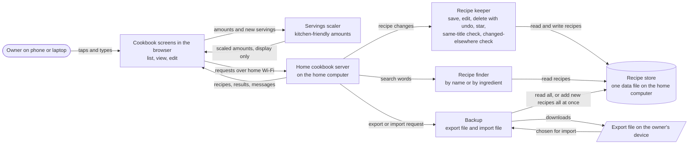

# High-level design — Home Cookbook

> From the approved SPEC (2026-11-13). Implementation-light: names responsibilities and where data lives; the LLD picks languages and packages.
> Diagram source: `.results/hld/hld.mmd` (same diagram as below).

## Problem & goal
Family recipes are scattered and at risk of being lost. Home Cookbook is a private recipe box that runs on the owner's home computer and is opened from a browser on their phone or laptop over the home Wi-Fi. The owner saves recipes, finds them by name or ingredient, scales them to the number of people eating with kitchen-friendly amounts, stars favourites so they sit on top, and exports everything to one file that any later version of the app can load back in.

## Users & main use cases
- **The owner, cooking (phone, a few times a week):** open the list, search, open a recipe, scale servings, cook (F-2, F-3).
- **The owner, at the laptop (occasional batches):** add and tidy recipes, delete with undo, export a backup, import one back (F-1, F-4, F-5, F-6).
- One person, usually one device at a time; both devices are windows onto the single copy on the home computer.

## Scope
- In: US-01..US-09: add/edit/delete-with-undo recipes, unique titles, "changed on another device" warning, search by name and by ingredient, scaling in the same unit with kitchen fractions, favourites on top, export all, import (add alongside, skip same title, all or nothing, every older export accepted forever). Mobile-first layout plus desktop. Runs on the home computer, reachable on the home Wi-Fi only.
- Out (copied from SPEC §11):
  - No accounts, logins or multiple users.
  - No cloud hosting, online sync or use away from home.
  - No offline copy on the phone.
  - No sharing recipes with other people (links, social, email).
  - No meal planning, shopping lists or nutrition information.
  - No unit conversion between or within measuring systems.
  - No importing from other recipe apps or websites; only this app's own export file.
  - No photos on recipes.
  - No passwords or per-person access on the home Wi-Fi.

## Success metrics
From SPEC §12 (Definition of done) and §9:
- A recipe added on the phone appears on the laptop (one shared copy).
- "pie" by name and "buttermilk" by ingredient return exactly the matching recipes; the list narrows while typing.
- 8 → 4 servings shows ½ cup, not 0.375 cup; the saved recipe is unchanged.
- A starred recipe is listed above every non-starred recipe.
- Delete then "Undo" within ~10 seconds restores the recipe unchanged, star included.
- Export 42 → empty the app → import gives back all 42 with every field identical; an export from an earlier version imports with every field intact.
- No change is ever overwritten silently when two devices save the same recipe.
- Any screen opens in under 1 second with ~500 recipes.

## Modules
| Module | Responsibility | Talks to |
|---|---|---|
| **Cookbook screens** (browser) | The three screens: Recipe list (search box with name/ingredient toggle, favourites first then A–Z, stars, "No recipes yet" / "No recipes match" states, "deleted · Undo" bar, menu with Export/Import), Recipe view (servings stepper, "Scaled from 8 servings · Reset"), Recipe edit (ingredient and step rows, title error, "Discard changes?", "changed on another device" dialog). Holds nothing permanently; every saved fact comes from the server. | Home cookbook server, Servings scaler |
| **Servings scaler** | Pure calculation: given ingredient amounts, original and new servings, returns kitchen-friendly amounts in the same unit (whole + ¼ ⅓ ½ ⅔ ¾; unit-less counts to nearest ½; never rounds to 0, shows ¼ instead; ingredients without an amount untouched). Display only, never saves. | Called by Cookbook screens (no other links) |
| **Home cookbook server** (home computer) | Serves the screens to browsers on the home Wi-Fi and is the single entry point for every read and change. Turns requests into calls on the modules below and their results into messages the screens show. Not reachable from outside the home network. | Cookbook screens, Recipe keeper, Recipe finder, Backup |
| **Recipe keeper** | The rules for one recipe: validate (title and servings required, servings whole ≥ 1, amount optional), refuse a title that matches another recipe ignoring case and edge spaces, keep a change marker per recipe so a save made from a stale form is refused with "changed on another device" until the owner picks "Reload theirs" or "Keep mine" (starring does not count as a change), star/unstar, delete with a ~10 second undo window (a newer delete makes the earlier one final), and list recipes favourites first then A–Z. | Home cookbook server, Recipe store |
| **Recipe finder** | Search by name (title contains the words, any case) or by ingredient (any ingredient name contains the words). Never returns recipes waiting out their undo window. | Home cookbook server, Recipe store |
| **Backup** | Export: write every recipe and every field (including favourites) to one file named `cookbook-<date>` carrying a format version and a "Home Cookbook export" marker; works with 0 recipes. Import: recognise the file (anything else → "isn't a Home Cookbook export; nothing was changed"), upgrade older format versions step by step to the current one, add recipes alongside existing ones, skip titles already in the app, rename duplicates inside the file with " (2)", and apply everything in one go or not at all; report "Imported N · skipped M". | Home cookbook server, Recipe store |
| **Recipe store** (home computer) | The one permanent copy of all recipes: title, servings, ordered ingredient lines (amount, unit, name), ordered steps, favourite flag, created/updated dates, change marker, and the pending-delete mark during the undo window. A single local data file on the home computer; supports all-or-nothing writes so an import or save never half-finishes. | Recipe keeper, Recipe finder, Backup |

### Where data lives
- **Recipes:** only in the Recipe store on the home computer. Phone and laptop keep nothing beyond the screen currently shown.
- **Export files:** on whichever device downloaded them; the app never keeps or sends them anywhere.
- **Scaled amounts:** computed for display, never stored.

### User story → module mapping
| Story | Main module | Also involved |
|---|---|---|
| US-01 Add a recipe (unique title) | Recipe keeper | Cookbook screens (edit), Home cookbook server, Recipe store |
| US-02 Read comfortably on phone | Cookbook screens (view) | Home cookbook server |
| US-03 Edit / delete with undo / changed on another device | Recipe keeper | Cookbook screens (edit, list undo bar), Recipe store |
| US-04 Search by name | Recipe finder | Cookbook screens (list) |
| US-05 Search by ingredient | Recipe finder | Cookbook screens (list) |
| US-06 Scale servings | Servings scaler | Cookbook screens (view) |
| US-07 Favourites on top | Recipe keeper | Cookbook screens (list, view star), Recipe store |
| US-08 Export all | Backup | Cookbook screens (menu), Recipe store |
| US-09 Import (skip same title, old files forever, all or nothing) | Backup | Cookbook screens (menu, result message), Recipe store |

## Data flow
Source file: `.results/hld/hld.mmd`.

## Milestones
Risk checkpoints only (no external integrations in this project).

| # | Milestone | Outcome |
|---|---|---|
| M1 | First recipe end to end (data model locked) | "Grandma's Apple Pie" added in a browser is saved on the home computer, shows in the list and reopens exactly as typed. The recipe fields are fixed from here on, since every later export must keep loading forever. |
| M2 | Backup format locked | Export 42 recipes, empty the app, import the file: all 42 back with every field identical; a bad file is refused with nothing changed. The export format carries a version from its first release so older files can always be upgraded. |
| M3 | Ready at home (before deploy) | The app runs on the owner's home computer; the phone on the home Wi-Fi opens it, a recipe added on the phone appears on the laptop, and it is not reachable from outside the home. |

## Risks & assumptions
**Risks**
- **"Every export loads forever" (SPEC §9, §13).** The biggest long-term risk. Mitigation: the export file carries a format version from day one; Backup keeps an upgrade step for every past version and never removes one; a saved sample export from each version is kept as a test fixture so a later change cannot break an old file.
- **Two devices editing the same recipe.** Mitigation: per-recipe change marker checked on save (Recipe keeper); starring excluded so it never triggers the warning.
- **Undo window vs. a closed browser.** The delete must finish on the home computer even if the phone is locked or the tab closed; the server, not the screen, owns the ~10 second window, and hides the recipe from list and search during it.
- **Data loss if the home computer dies.** Accepted by the owner: backup is manual export (consequence line in SPEC §13). The Recipe store writes all-or-nothing so a power cut mid-save cannot corrupt the file.
- **Reachability.** Phone access depends on the home computer being on and on the home Wi-Fi allowing it; the M3 checkpoint proves this on the owner's real network.
- **Open spec gap G-9:** a recipe deleted on another device while being edited here. Not covered by the spec; the LLD should pick a safe default (nothing lost: offer to save it as new) and list it for the owner.

**Assumptions** (planner, Tier 2; owner can overrule)
- Scaling runs in the browser so the amounts change instantly; it needs no server round trip and stores nothing.
- Search over ~500 recipes is fast enough without a separate search index; where the matching runs (browser or home computer) is an LLD choice.
- Duplicate-title comparison (case and edge spaces ignored) is one shared rule used by both Recipe keeper and Backup.
- Whether the app starts by itself after the home computer restarts is left to env-setup/deploy; it does not change the design.
