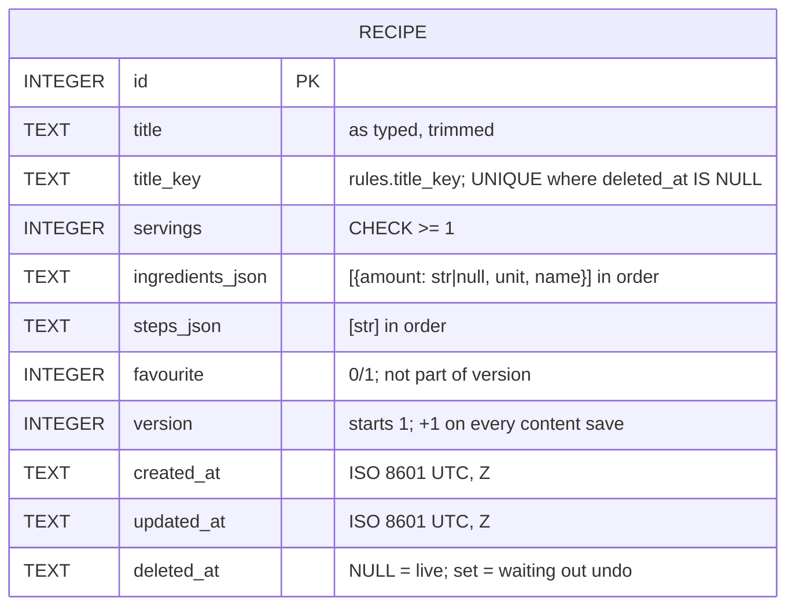

# Low-level design — Home Cookbook

> Numbered, self-contained sections: brief a task with only the sections it needs (e.g. `LLD §1, §3`). Numbers are stable: update in place, new sections get new numbers, removed ones are marked `(removed)`.
> Size: medium (cap 400 lines). From SPEC, HLD (D-14), research, DECISIONS D-01..D-26, A-01..A-04. Diagram sources: `.results/plan/lld-components.mmd`, `lld-erd.mmd`, `lld-seq-save.mmd`, `lld-seq-delete-undo.mmd`, `lld-seq-import.mmd`.

## §0 Overview
### §0.1 Stack
| Layer | Choice | Why | Rejected alternative |
|---|---|---|---|
| Language | Python 3.12 (uv-managed 3.12.11, `.python-version`) | Playwright's greenlet does not build on the system 3.14; verified OK on 3.12 | System Python 3.14 (greenlet compile fails) |
| Server | Flask 3.1.3 + Jinja2, sync | Fewest concepts, pure Python, server-rendered pages plus a few JSON endpoints | FastAPI (async/pydantic add nothing for one user); Django (oversized) |
| HTTP server | waitress 3.0.2, 4 threads | Pure Python production server, one command | Werkzeug dev server (fallback only); gunicorn (extra moving part) |
| Data | SQLite via stdlib `sqlite3`, WAL + `synchronous=FULL` | One file, all-or-nothing transactions, race-free version check | One JSON file (hand-written durability); SQLAlchemy (layer with no gain) |
| Front end | Jinja pages + vanilla JS ES modules, no build, no Node | 3 screens; instant scaling and undo need ~300 lines of JS | htmx/Alpine (dependency for small gain); SPA (duplicate routing/validation) |
| Tests | pytest + Playwright for Python, Playwright's own Chromium headless shell | One language and runner; Chromium shell verified on this Arch machine | Node @playwright/test (second toolchain); system Chromium (not needed) |

### §0.2 Folder structure
```
pyproject.toml  uv.lock  .python-version  .env.example  .secrets.baseline  scripts/check.sh
src/cookbook/
  __main__.py              # calls cookbook.app.serve.main()
  app/      factory.py (create_app, composition root) · config.py (Settings) · serve.py (waitress, address banner)
  domain/   models.py · rules.py · amounts.py · search.py · errors.py · ports.py        (§1, pure)
  adapters/ schema.py · sqlite_repo.py · clock.py                                       (§2)
  services/ keeper.py (§3) · finder.py (§4) · backup/service.py, backup/formats.py (§5)
  web/      __init__.py (services()) · guard.py · errors.py · messages.py · pages.py · api.py   (§6)
  templates/ base.html · list.html · _list_items.html · view.html · edit.html · error.html   (§7)
  static/   css/app.css · js/api.js · js/undo.js · js/list.js · js/view.js · js/edit.js · js/menu.js · js/scaler.js
tests/ unit/ · integration/ · e2e/ · fixtures/exports/ · conftest.py
```
Python under `src/cookbook/` (except templates/static) is backend-coder's; `templates/` and `static/` are frontend-coder's (`.devteam/scopes.json`).

### §0.3 Layer map and module dependencies
`app` → `web` → `services` → `domain`; `adapters` → `domain`. `services` and `adapters` never import each other; `web` never imports `adapters`. `cookbook.app.factory.create_app` is the only composition root. Component diagram: `.results/plan/lld-components.mmd`.

| § | Module | Depends on |
|---|---|---|
| §1 | domain | nothing (stdlib only) |
| §2 | adapters | §1 |
| §3 §4 §5 | services | §1 (ports, not §2) |
| §6 | web | §1, §3, §4, §5 |
| §7 §8 | templates/JS | §6 contracts only |

import-linter contracts (in `pyproject.toml`, `include_external_packages = true`):
```toml
[[tool.importlinter.contracts]]
name = "Layers point inward"
type = "layers"
layers = ["cookbook.app", "cookbook.web", "cookbook.services | cookbook.adapters", "cookbook.domain"]
[[tool.importlinter.contracts]]
name = "Web never touches storage"
type = "forbidden"
source_modules = ["cookbook.web"]
forbidden_modules = ["cookbook.adapters"]
[[tool.importlinter.contracts]]
name = "No web framework below web"
type = "forbidden"
source_modules = ["cookbook.domain", "cookbook.services", "cookbook.adapters"]
forbidden_modules = ["flask", "werkzeug", "waitress"]
```
`sqlite3` is banned everywhere except `src/cookbook/adapters/**` via ruff `TID251` (CONVENTIONS §1).

### §0.4 Packages
Python pinned to 3.12 via uv (`requires-python = "~=3.12.0"`). Exact pins live in `uv.lock`; "≥" rows take the latest stable on env-setup day (not verified by me on this date).
| Package | Version | Purpose | Plain words | Alternative rejected |
|---|---|---|---|---|
| flask | 3.1.3 | Web pages, JSON endpoints | The part that answers the browser | FastAPI, Django |
| werkzeug, jinja2 | 3.1.9, via flask | Request parsing, uploads; HTML templates | Comes with Flask | — |
| waitress | 3.0.2 | Serves the app on the home network | The always-on doorman for the app | Werkzeug dev server, gunicorn |
| pytest | 9.2.0 | Test runner (dev) | Runs the automatic checks | unittest |
| pytest-cov | ≥7.0 | Coverage threshold (dev) | Measures how much code the checks touch | coverage CLI alone |
| playwright | 1.49.1 (D-28: 1.65.1 hung ~30s on browser.close() here) | Drives Chromium for phone-size end-to-end tests (dev) | A robot that taps through the screens | Selenium, Node Playwright |
| pytest-playwright | 0.10.0 | `page` fixture, phone viewport (dev) | Plugs the robot into the checks | hand-written fixtures |
| ruff | ≥0.14 | Lint + format + complexity + banned imports (dev) | Spell-checker for code style | flake8 + black + isort |
| mypy | ≥1.18 | Strict type checking (dev) | Catches mixed-up data before running | pyright (needs Node) |
| import-linter | ≥2.5 | Enforces §0.3 layers (dev) | Keeps each part in its lane | review only |
| radon | 6.0.1 | Complexity report (dev) | Flags tangled functions | ruff C901 alone |
| types-waitress | latest | Type stubs for waitress (dev) | Lets the type checker read waitress | `# type: ignore` |
| detect-secrets | 1.5.0 | Secrets scan (dev) | Stops passwords landing in files | gitleaks (needs a system install) |

No JavaScript packages, no Node.

### §0.5 Config and secrets
No secrets exist. `Settings.from_env()` (`app/config.py`) reads, all documented in `.env.example`:
| Env var | Default | Meaning |
|---|---|---|
| `COOKBOOK_HOST` | `0.0.0.0` | Interface to listen on (all home-network interfaces) |
| `COOKBOOK_PORT` | `8765` | Port the phone/laptop use |
| `COOKBOOK_DB` | `$XDG_DATA_HOME/home-cookbook/cookbook.db` (else `~/.local/share/...`) | Data file, outside the code folder so reinstalling code keeps recipes |
| `COOKBOOK_UNDO_SECONDS` | `10` | Undo bar length; server accepts undo for this + 2 s grace |
Invalid values → `serve.main()` exits 2 with one-line message. Tests build `Settings(...)` directly.

### §0.6 Starting the app and reaching it from the phone
- Start on the home computer, in the project folder: `uv run cookbook` (same as `uv run python -m cookbook`). Stop with Ctrl+C. Auto-start on boot is out of scope (D-15).
- `serve.main()` creates the data folder and file, logs `Home Cookbook is running. On your phone or laptop open: http://<lan-ip>:8765 (or http://<hostname>.local:8765)`. LAN IP found via a UDP socket `connect(("192.0.2.1", 9))` + `getsockname()` (sends nothing); fallback `127.0.0.1`.
- Binds `0.0.0.0:8765` (waitress `threads=4`, `max_request_body_size=5 MB`). Reachable only inside the home: home routers do not forward ports unless told to (never do), and `web/guard.py` (§6.5) answers 403 to any address that is not private/loopback/link-local.
- If a firewall (ufw/firewalld) is active, env-setup allows TCP 8765 from the local subnet only. The `.local` name needs avahi on the computer; the IP always works.

### §0.7 Shared modules (foundation task builds first; feature tasks never edit them)
`domain/` (all of §1), `adapters/` (§2), `app/` (§0.5, §0.6, §6.1), `web/__init__.py`, `web/guard.py`, `web/errors.py`, `web/messages.py` (§6), `templates/base.html`, `templates/error.html`, `static/css/app.css`, `static/js/api.js`, `static/js/undo.js` (§7.1). Feature tasks add routes in `web/pages.py`/`web/api.py` per their section and their own template/JS files.

## §1 Domain (shared, pure)
- **Responsibility:** recipe data types, validation and shared rules; no I/O.
- **Path(s):** `src/cookbook/domain/`
- **Depends on:** none

### §1.1 Interfaces / signatures
```python
# models.py — frozen, slotted dataclasses; datetimes are timezone-aware UTC
class Ingredient: amount: str | None; unit: str; name: str          # amount stored exactly as typed (trimmed)
class RecipeDraft: title: str; servings: int; ingredients: tuple[Ingredient, ...]; steps: tuple[str, ...]
class NewRecipe: draft: RecipeDraft; favourite: bool; created_at: datetime; updated_at: datetime
class Recipe: id: int; title: str; servings: int; ingredients: tuple[Ingredient, ...]; steps: tuple[str, ...]
              favourite: bool; version: int; created_at: datetime; updated_at: datetime; deleted_at: datetime | None
              def draft(self) -> RecipeDraft
class RecipeSummary: id: int; title: str; servings: int; favourite: bool
class SearchBy(StrEnum): NAME = "name"; INGREDIENT = "ingredient"
# rules.py
def title_key(title: str) -> str                    # NFC, strip, casefold: the one same-title rule (F-1, F-6)
def parse_draft(raw: Mapping[str, object]) -> RecipeDraft     # raises InvalidRecipe(fields)
def list_order(recipes: Iterable[Recipe]) -> list[RecipeSummary]  # favourites first, then title_key A–Z, then id
def free_title(title: str, taken_keys: set[str]) -> str      # "T" or first free "T (2)", "T (3)"…
# amounts.py
def parse_amount(text: str) -> Fraction             # raises ValueError; see §1.4
def display_amount(text: str) -> str                # kitchen form of a valid amount ("2.5"→"2½", "1 1/2"→"1½"); §1.4
# search.py
def normalise(text: str) -> str                     # NFKD, drop accents, drop ' and ’, casefold, collapse spaces
def matches(recipe: Recipe, query: str, by: SearchBy) -> bool
# errors.py — all subclass CookbookError
InvalidRecipe(fields: dict[str, str]) · DuplicateTitle(existing_title) · RecipeNotFound · ChangedElsewhere(current_version)
DeletedElsewhere · UndoExpired(title) · NotAnExport(reason) · NewerExportFormat(found: int, supported: int) · ImportInterrupted
# ports.py — the two variation points
class RecipeRepository(Protocol): ...               # methods in §2.1
class Clock(Protocol): def now(self) -> datetime
```

### §1.2 Validation rules (`parse_draft`)
| Field | Rule | Field key on error |
|---|---|---|
| title | str, stripped, 1–200 chars | `title` |
| servings | whole number 1–1000 (int, or digit string) | `servings` |
| ingredients | list ≤ 100; rows with amount, unit and name all blank are dropped; name 1–200 required; unit ≤ 30; amount blank → `None`, else must pass `parse_amount` | `ingredients.<i>.name` / `.amount` |
| steps | list ≤ 100 of str; blank dropped; each ≤ 10 000 chars | `steps.<i>` |
Error texts live in `web/messages.py` (§6.4); `fields` maps key → short code (`required`, `too_long`, `not_whole`, `bad_amount`, `range`).

### §1.4 Edge cases (storage in §2.3, file format in §5.3)
- Amounts accepted (D-22): `2`, `1.5`, `0,5`, `3/4`, `1 1/2`, `½`, `1½`, `1 ½` (glyphs ¼ ½ ¾ ⅓ ⅔ ⅛ ⅜ ⅝ ⅞). `1 1/2` is always one and a half. Must be > 0. Ranges (`2-3`, `2 to 3`) and anything else refused: `bad_amount` (§6.4). Stored as typed; `display_amount` shows whole + glyph when the value is exactly that ("2.5"→"2½"), else the typed text unchanged ("0.3").
- Search (D-24): every query word must appear in the target after `normalise` (name: title; ingredient: one ingredient's name). Part-words match (`egg` finds `eggs` and `eggplant`, `APP` finds `Apple`), `shepherds` finds `Shepherd's`, `creme` finds `Crème`. Empty query matches all.

## §2 Recipe store adapter (shared)
- **Responsibility:** the one permanent copy of recipes in SQLite; all-or-nothing writes; the system clock.
- **Path(s):** `src/cookbook/adapters/`
- **Depends on:** §1

### §2.1 Interfaces / signatures
```python
class SqliteRecipeRepository:            # implements domain.ports.RecipeRepository
    def __init__(self, db_path: Path) -> None          # opens a new connection per call (thread-safe under waitress)
    def init_schema(self) -> None                      # create/migrate via PRAGMA user_version
    def list_live(self) -> list[Recipe]
    def get(self, recipe_id: int, *, include_deleted: bool = False) -> Recipe | None
    def live_title_keys(self) -> set[str]
    def add(self, new: NewRecipe) -> Recipe                       # DuplicateTitle on unique-index clash
    def add_many(self, items: Sequence[NewRecipe]) -> None        # one transaction; any clash rolls back all
    def update_if_version(self, recipe_id: int, draft: RecipeDraft, base_version: int, now: datetime) -> Recipe | None
        # UPDATE … SET …, version = version + 1 WHERE id=? AND version=? AND deleted_at IS NULL; None if 0 rows
    def set_favourite(self, recipe_id: int, favourite: bool) -> bool   # live rows only; version unchanged
    def mark_deleted(self, recipe_id: int, now: datetime) -> Recipe | None  # same transaction purges every other pending row
    def unmark_deleted(self, recipe_id: int, title: str) -> Recipe | None   # title may be renamed by caller
    def purge_deleted_before(self, cutoff: datetime) -> int
class SystemClock:                       # implements domain.ports.Clock
    def now(self) -> datetime            # datetime.now(UTC)
```

### §2.3 Data / schema owned (`schema.py`, `user_version = 1`)

Every connection: `PRAGMA journal_mode=WAL; PRAGMA synchronous=FULL; PRAGMA foreign_keys=ON; PRAGMA busy_timeout=5000`. Schema changes are forward-only migrations keyed by `user_version`, never edited once released (data model locked at M1).

### §2.5 Errors and edge cases
- `sqlite3.IntegrityError` on `recipe_title_live` → `DuplicateTitle(existing_title)` (looked up in the same connection). Other `sqlite3.Error` propagate (→ 500). Purged rows are gone for good; `get(..., include_deleted=True)` returns `None` for them.

## §3 Recipe keeper (US-01, US-03, US-07)
- **Responsibility:** create, edit (with changed-elsewhere and deleted-elsewhere checks), star, delete with undo, list.
- **Path(s):** `src/cookbook/services/keeper.py`; routes in `web/api.py`, `web/pages.py` (§6)
- **Depends on:** §1 (`RecipeRepository`, `Clock`)

### §3.1 Interfaces / signatures
```python
class RecipeKeeper:
    def __init__(self, repo: RecipeRepository, clock: Clock, undo_seconds: int) -> None
    def list_recipes(self) -> list[RecipeSummary]       # purges expired pending deletes first
    def get(self, recipe_id: int) -> Recipe             # RecipeNotFound if missing or pending-deleted
    def create(self, draft: RecipeDraft) -> Recipe      # DuplicateTitle
    def update(self, recipe_id: int, draft: RecipeDraft, base_version: int) -> Recipe
        # DeletedElsewhere (missing/pending) → ChangedElsewhere(current_version) → DuplicateTitle (other recipe)
    def set_favourite(self, recipe_id: int, favourite: bool) -> None   # DeletedElsewhere
    def delete(self, recipe_id: int) -> Recipe          # RecipeNotFound; earlier pending delete becomes final
    def restore(self, recipe_id: int) -> tuple[Recipe, str | None]
        # UndoExpired if now > deleted_at + undo_seconds + 2 s or row purged; returns renamed title if its name was taken meanwhile
```

### §3.2 Contracts (JSON; errors are `{"error": code, "message": str, ...}`, §6.3)
| Method | Path | Request | Response | Errors |
|---|---|---|---|---|
| POST | `/api/recipes` | `{"recipe": RecipeIn}` | 201 `{"id", "version"}` | 422 `invalid` + `fields`; 409 `duplicate_title` + `existing_title` |
| PUT | `/api/recipes/<id>` | `{"base_version": int, "recipe": RecipeIn}` | 200 `{"id", "version"}` | 409 `changed_elsewhere` + `current_version`; 410 `deleted_elsewhere`; 409 `duplicate_title`; 422 `invalid` |
| PUT | `/api/recipes/<id>/favourite` | `{"favourite": bool}` | 200 `{"favourite"}` | 410 `deleted_elsewhere` |
| DELETE | `/api/recipes/<id>` | — | 200 `{"id", "title", "undo_seconds"}` | 404 `not_found` |
| POST | `/api/recipes/<id>/restore` | — | 200 `{"id", "title", "renamed_to": str\|null}` | 410 `undo_expired` |
`RecipeIn` = `{"title": str, "servings": int|str, "ingredients": [{"amount": str, "unit": str, "name": str}], "steps": [str]}`.
Pages: `GET /recipes/new`, `GET /recipes/<id>/edit` (404 page if not live) — context in §7.4.

### §3.4 Key sequences
Save from a stale form (`lld-seq-save.mmd`): `PUT {base_version: 3}` → `update` → `repo.get(id, include_deleted=True)`: missing or `deleted_at` set → 410 (deleted dialog, D-21, §3.5); stored version 4 ≠ 3 → 409 `changed_elsewhere` with `current_version: 4` → dialog **Reload theirs** (open `/recipes/<id>`, typing dropped) / **Keep mine** (PUT again with `base_version: 4`); equal → `update_if_version` (returns `None` if another save won the race → `ChangedElsewhere`) → 200 → read view.
Delete and undo (`lld-seq-delete-undo.mmd`): DELETE sets `deleted_at` and purges other pending rows; `undo.js` stores `{id, title, until}` in `sessionStorage` and shows the bar on whatever page is open until `until`; Undo → POST restore; after the window the row is hidden everywhere and purged on the next list or delete.

### §3.5 Errors and edge cases
- Starring never bumps `version`, so it never triggers the warning; "Keep mine" and "Reload theirs" both keep the current star. Saving an unchanged form still bumps `version` (simple; harmless).
- **Deleted elsewhere while edited here (D-21):** the form and every typed character stay; dialog `deleted_elsewhere` (§6.4) offers **Save as new** (POST `/api/recipes` with the typed data → read view; title rule applies) and **Discard my changes** (to the list; the recipe stays deleted). Nothing is saved until one is chosen. If the delete was undone before Save, the PUT finds the row live and saves as normal.
- After **Save as new** is chosen the form stays a new recipe (POST) for the rest of its life: a 409 `duplicate_title` (e.g. the other device tapped Undo first) shows `title-error`, typing kept.
- Restore when the title was reused during the window: restored as `free_title(title, …)`, e.g. "Lemon Cake (2)", and the bar says so (`restored_renamed`). This includes "Save as new" recreating the title while the other device's Undo bar still shows: Undo is never refused for the title, so neither recipe is lost.

## §4 Recipe finder (US-04, US-05, F-2 list)
- **Responsibility:** live search by name or ingredient over live recipes, ordered like the list.
- **Path(s):** `src/cookbook/services/finder.py`; route in `web/pages.py`
- **Depends on:** §1

### §4.1 Interfaces / signatures
```python
class RecipeFinder:
    def __init__(self, repo: RecipeRepository) -> None
    def search(self, query: str, by: SearchBy) -> list[RecipeSummary]   # list_live → filter rules via search.matches → list_order
```
Runs on the home computer over all ~500 rows in Python (no index; well under 1 s) (A-02).

### §4.2 Contracts
| Method | Path | Request | Response | Errors |
|---|---|---|---|---|
| GET | `/` | `?q=&by=name\|ingredient` (optional) | list page (§7.2) | bad `by` → treated as `name` |
| GET | `/recipes/_list` | `?q=&by=` | HTML fragment `_list_items.html` (same context as §7.2) | same |

## §5 Backup (US-08, US-09)
- **Responsibility:** export every live recipe to one versioned file; import any past version all-or-nothing.
- **Path(s):** `src/cookbook/services/backup/service.py`, `backup/formats.py`; routes in `web/api.py`
- **Depends on:** §1

### §5.1 Interfaces / signatures
```python
CURRENT_FORMAT_VERSION: Final = 1
UPGRADES: Final[dict[int, Callable[[dict[str, Any]], dict[str, Any]]]] = {}   # n → step from n to n+1
def upgrade(doc: dict[str, Any]) -> dict[str, Any]     # applies UPGRADES[v] for v = found … CURRENT-1
def to_document(recipes: Sequence[Recipe], exported_at: datetime, app_version: str) -> dict[str, Any]
def from_document(doc: dict[str, Any], now: datetime) -> list[NewRecipe]   # NotAnExport on any bad field
@dataclass(frozen=True) class ExportFile: filename: str; content: bytes
@dataclass(frozen=True) class ImportResult: imported: int; skipped: int; renamed: int; skipped_titles: tuple[str, ...] = ()
    # skipped_titles (D-30): each skipped recipe's title as spelled in the file (after parse_draft trim), file order;
    # invariant skipped == len(skipped_titles)
class BackupService:
    def __init__(self, repo: RecipeRepository, clock: Clock, app_version: str) -> None
    def export_all(self) -> ExportFile               # filename cookbook-YYYY-MM-DD.json (home computer's local date)
    def import_file(self, data: bytes) -> ImportResult   # NotAnExport, NewerExportFormat
```

### §5.2 Contracts
| Method | Path | Request | Response | Errors |
|---|---|---|---|---|
| GET | `/export` | — | 200 `application/json`, `Content-Disposition: attachment; filename="cookbook-2026-11-13.json"` | — |
| POST | `/api/import` | multipart, field `file` | 200 `{"imported", "skipped", "renamed", "message"}` | 400 `not_an_export`; 400 `newer_version`; 413 → `not_an_export`; 409 `import_interrupted` |

### §5.3 Export file format, version 1 (frozen at M2)
UTF-8 JSON, indented 2, non-ASCII kept (readable on a phone, G-12):
```json
{"format": "home-cookbook-export", "format_version": 1, "app_version": "1.0.0",
 "exported_at": "2026-11-13T18:02:11Z", "recipe_count": 1,
 "recipes": [{"title": "Grandma's Apple Pie", "servings": 8, "favourite": true,
   "ingredients": [{"amount": "2", "unit": "cups", "name": "flour"}, {"amount": null, "unit": "", "name": "salt, to taste"}],
   "steps": ["Preheat oven to 200°C", "…"],
   "created_at": "2026-11-13T09:00:00Z", "updated_at": "2026-11-13T09:10:00Z"}]}
```
**Upgrade rule (forever, D-12/A-04):** any change to this shape bumps `format_version` to n+1 and adds `UPGRADES[n]` (pure dict → dict). Existing steps and frozen fixtures `tests/fixtures/exports/v<n>-*.json` are never edited or removed; a test imports every fixture and checks every field. The format is independent of the DB schema (§2.3). A file whose `format_version` is higher than the app's is refused ("made by a newer version"), never guessed at.

### §5.4 Key sequence (`lld-seq-import.mmd`)
Decode UTF-8 → `json.loads` → check `format == "home-cookbook-export"` and int `format_version` → `upgrade` → `from_document` (each recipe through `parse_draft`; `recipe_count` must equal `len(recipes)`; missing dates → now) → plan against `live_title_keys()`: same title as the app → skip and record the file's title in `skipped_titles`; repeated title inside the file → `free_title` → `add_many` in one transaction → `ImportResult`.

### §5.5 Errors and edge cases
- Not UTF-8, not JSON, wrong marker, missing/invalid field, count mismatch, > 5 MB → `NotAnExport`; nothing written.
- Unique-index clash during `add_many` (another device saved meanwhile) → rolled back, `ImportInterrupted` → 409 `import_interrupted`.
- Export with 0 recipes → valid file, `recipe_count: 0`. Pending-deleted recipes are not exported. Unknown extra keys are ignored.

## §6 Web server (shared parts + route rules)
- **Responsibility:** composition root, request guard, error mapping, user-facing texts, routes.
- **Path(s):** `src/cookbook/app/`, `src/cookbook/web/`
- **Depends on:** §1, §3, §4, §5 (+ §2 only inside `app/factory.py`)

### §6.1 Interfaces / signatures
```python
# app/factory.py
def create_app(settings: Settings, clock: Clock | None = None) -> Flask
    # builds SqliteRecipeRepository(settings.db_path).init_schema(), keeper, finder, backup;
    # stores Services(keeper, finder, backup) in app.extensions["cookbook"]; registers guard, errors, blueprints;
    # MAX_CONTENT_LENGTH = 5 MB
# web/__init__.py
@dataclass(frozen=True) class Services: keeper: RecipeKeeper; finder: RecipeFinder; backup: BackupService
def services() -> Services                 # reads current_app.extensions["cookbook"]
# app/serve.py
def main() -> None                         # Settings.from_env → create_app → banner → waitress.serve
```

### §6.3 Error mapping (`web/errors.py`; only place exceptions become HTTP)
| Exception | API status · code | Page |
|---|---|---|
| InvalidRecipe | 422 `invalid` + `fields` (key → message) | — |
| DuplicateTitle | 409 `duplicate_title` | — |
| ChangedElsewhere | 409 `changed_elsewhere` + `current_version` | — |
| DeletedElsewhere | 410 `deleted_elsewhere` | — |
| RecipeNotFound | 404 `not_found` | 404 `error.html` "That recipe isn't here any more" + link to list |
| UndoExpired | 410 `undo_expired` | — |
| NotAnExport / 413 | 400 `not_an_export` | — |
| NewerExportFormat | 400 `newer_version` | — |
| ImportInterrupted | 409 `import_interrupted` | — |
| other | 500 `server_error`, logged with traceback | 500 `error.html` |
Malformed JSON body → 400 `bad_request`.

### §6.4 Messages (`web/messages.py`; single source of truth for every user-facing text: coders and tester follow it over the wireframes)
| Key | Text |
|---|---|
| duplicate_title | You already have a recipe called '{existing}'. Please choose another name, e.g. '{existing} (Gran's)' |
| changed_elsewhere | This recipe changed on another device · buttons "Reload theirs", "Keep mine" |
| deleted_elsewhere | This recipe was deleted on another device · buttons "Save as new", "Discard my changes" · leave-with-changes confirm (§7.4): "Discard changes?" |
| not_an_export | This file isn't a Home Cookbook export; nothing was changed |
| newer_version | This file was made by a newer version of Home Cookbook. Update the app to load it; nothing was changed |
| undo_expired | Too late to undo; '{title}' is gone |
| import_interrupted | Something changed while importing; nothing was changed, please try again |
| imported | Imported {n} recipe(s) [· skipped {m} with the same title: {titles}] [· renamed {k} with a repeated title] [. To restore one, delete it first, then import again] · `{titles}` = `ImportResult.skipped_titles` joined with ", " (file spelling, file order, every one listed); the restore sentence appears only when {m} > 0 (D-30). E.g. "Imported 40 recipes · skipped 2 with the same title: Lemon Cake, Shepherd's Pie. To restore one, delete it first, then import again". Titles are plain text (`menu.js` sets `textContent`, never HTML) |
| restored_renamed | '{title}' is back as '{renamed}' because another recipe now has its name |
| field codes | required: "Please fill this in" · not_whole: "Use a whole number of 1 or more" · bad_amount: "Enter one amount, e.g. 2 or 2½" · too_long · range |

### §6.5 Request guard (`web/guard.py`, `before_request`)
1. `ipaddress.ip_address(request.remote_addr)` not private, loopback or link-local → 403 "Home Cookbook only answers inside the home".
2. POST/PUT/DELETE with an `Origin` header whose host:port ≠ `request.host` → 403 (stops other websites posting to the app).
Logging: stdlib `logging`, `key=value`, recipe ids not titles.

## §7 Screens (templates + JS)
- **Responsibility:** the three screens, mobile-first (390 px, no sideways scroll) with a desktop layout.
- **Path(s):** `src/cookbook/templates/`, `src/cookbook/static/`
- **Depends on:** §6 contracts; context variables below are provided by `web/pages.py` (backend).

### §7.1 Shared (foundation)
- `base.html`: viewport meta, `app.css`, header with menu (Export link to `/export`, Import button + hidden file input), `<div data-testid="undo-bar">`, loads `api.js`, `undo.js`, `menu.js` as `type="module"`.
- `api.js`: `export async function api(method: string, url: string, body?: object | FormData): Promise<{status: number, data: object}>` (sets JSON headers; never throws on HTTP errors).
- `undo.js`: `export function startUndo(id, title, seconds)`; on every page load re-shows the bar from `sessionStorage` until expiry (G-11); Undo → `POST /api/recipes/<id>/restore`, then reload.
- `menu.js`: import → `POST /api/import`, shows `message` in `data-testid="menu-message"`, reloads list on success.
- All interactive elements carry `data-testid`: `recipe-row`, `star`, `search-input`, `search-by-name`, `search-by-ingredient`, `clear-search`, `add-recipe`, `undo-button`, `servings-input`, `scaled-note`, `reset-scale`, `ingredient-line`, `step`, `edit`, `delete`, `save`, `cancel`, `title-error`, `conflict-dialog`, `reload-theirs`, `keep-mine`, `deleted-dialog`, `save-as-new`, `discard`, `import-input`, `menu-message`.

### §7.2 Recipe list (`list.html`, `_list_items.html`, `list.js`)
Context: `recipes: list[RecipeSummary]`, `q: str`, `by: str`, `total_live: int`. Empty states: `total_live == 0` → "No recipes yet" + Add recipe; no matches → "No recipes match '{q}'" + Clear search. `list.js`: on input (150 ms debounce) or toggle → `GET /recipes/_list?q=&by=` → replace list HTML; star → `PUT …/favourite` then refresh list.

### §7.3 Recipe view (`view.html`, `view.js`)
Context: `recipe: Recipe`, `lines: list[IngredientLine]` where `IngredientLine(amount_text: str | None, unit: str, name: str, qty_num: int | None, qty_den: int | None)` built in `pages.py` (`amount_text` = `display_amount`, qty from `parse_amount`). Each line renders `data-num`, `data-den`, `data-unit`, `data-text`; `view.js` picks the rounding via `kindFor(unit)` (§8). Servings stepper uses §8; shows "Scaled from {n} servings · Reset". Delete → `DELETE`, `startUndo`, go to `/`.

### §7.4 Recipe edit (`edit.html`, `edit.js`)
Context: `recipe: Recipe | None` (None = new), `form_json: str` (RecipeIn, embedded with `|tojson`), `version: int | None`. Ingredient and step rows: add, remove, move up/down (G-10). Save → POST or PUT (§3.2); 422 → messages beside fields, focus first; 409 duplicate → `title-error`; 409 changed → `conflict-dialog`; 410 → `deleted-dialog` (§3.5). Cancel/leave with changes → `confirm("Discard changes?")` and `beforeunload`; suppressed after a successful save or "Reload theirs".

## §8 Servings scaler (browser, pure)
- **Responsibility:** kitchen-friendly scaled amounts for display only (A-01, D-05, D-23).
- **Path(s):** `src/cookbook/static/js/scaler.js`; also assigned to `window.cookbookScaler` so Playwright tests call it via `page.evaluate`.
- **Depends on:** none

### §8.1 Interfaces / signatures
```js
export function kindFor(unit)  // "metric" | "counted" | "fraction"; see §8.5
export function scale(num, den, fromServings, toServings, kind)    // -> {whole: number, frac: "" | "¼" | "⅓" | "½" | "⅔" | "¾"}
export function formatAmount(result)                                // -> "1½", "½", "3", "84"
export function unitFor(unit, result)                               // "cups"↔"cup", "grams"↔"gram" etc. from a small table; unknown units unchanged
```

### §8.5 Rules and edge cases
- `kindFor`: unit trimmed and casefolded is `g`, `gram`, `grams`, `ml`, `millilitre(s)` or `milliliter(s)` → `metric` (D-23); blank → `counted`; anything else (incl. `kg`, `l`, `cup`) → `fraction`. Units are never converted.
- Exact integer arithmetic: q = num·to / (den·from). Candidates per whole by kind: `fraction` {0, ¼, ⅓, ½, ⅔, ¾, 1}; `counted` {0, ½, 1}; `metric` {0, 1} (whole numbers). Nearest by exact cross-multiplied distance; **ties go to the larger** candidate (so 62.5 g → 63 g); 1 carries into the whole.
- Result 0 → smallest step (SPEC F-3): 1 for `metric` (1 g / 1 ml); ½ for `counted` (matches its ½ rounding); ¼ for `fraction`.
- toServings = fromServings → `data-text` shown as is (no rounding). No amount → line unchanged; servings input < 1 or not whole → refused (input reset), saved recipe never changes.
- SPEC §5 checks: ¾ cup 8→4 = ⅜ → ⅓; 3 eggs 4→6 → 4½; ⅓ cup 4→6 → ½; 2 cups 8→4 → "1 cup"; 253 g 3→1 → "84 g"; 150 ml 3→1 → "50 ml"; 2 tbsp 3→1 → "⅔ tbsp".

## Changes since last milestone
| Milestone | Section | Change | Why | Ref |
|---|---|---|---|---|
